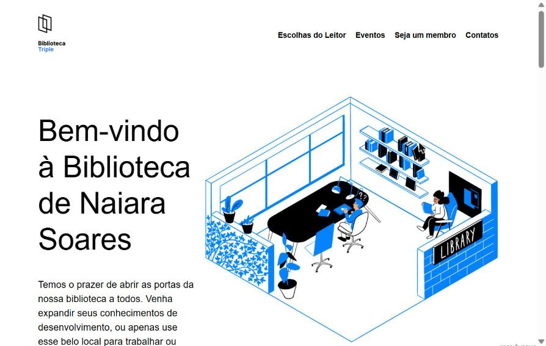

# Biblioteca Triple Peaks

Landing page de uma biblioteca fictícia, construída em HTML e CSS a partir de um layout no Figma. Projeto do curso de Desenvolvimento Front-end da TripleTen.

🔗 **Acesse:** https://naibalreira.github.io/biblioteca-triple-peaks/

## Seções da página

- **Cabeçalho** com navegação, título de boas-vindas e ilustração
- **Escolhas do Leitor**: cards de livros indicados sobre uma imagem de fundo
- **Próximos eventos**: destaque para um evento, com ícones de data e local e fotos posicionadas sobre a ilustração
- **Ser membro**: passo a passo em quatro etapas
- **Rodapé** com horário de funcionamento e redes sociais

## Tecnologias e técnicas

- HTML5 semântico
- CSS3 com Flexbox
- Posicionamento absoluto para compor as fotos sobre a ilustração
- Imagem de fundo com `background-size: cover`
- normalize.css

> A página foi desenvolvida para desktop (largura mínima de 1100 px), conforme o escopo do projeto.
